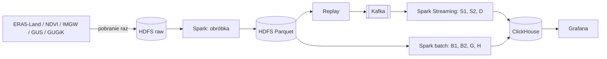

# Monitorowanie zagrożeń dla upraw — specyfikacja

*Rozproszone Przetwarzanie Danych w Big Data · plan pracy: [ROADMAP.md](ROADMAP.md)*

## 1. Projekt

Z historycznych danych pogodowych i satelitarnych liczymy zagrożenia dla upraw w regionach Polski. Część procesów to **strumień** (alerty co godzinę), część **batch** (całe sezony). Strumień symulujemy: archiwalne dane odtwarzamy do Kafki, jakby przychodziły na żywo. Dane pobieramy raz, więc demo zawsze działa tak samo. Wyniki: ClickHouse + Grafana.

## 2. Rolnictwo w pigułce

- **Oziminy** (pszenica, rzepak) — siane jesienią, zimują w polu, zbiór w lipcu. **Jare** (jęczmień, kukurydza, ziemniaki, buraki) — siane wiosną.
- **Plon** — dt/ha (1 dt = 100 kg); pszenica ok. 45–60 dt/ha.
- **NDVI** — „zieloność” ze zdjęć satelitarnych (0,1 goła ziemia … 0,9 pełny wzrost). W roku ma kształt górki ze szczytem w maju–czerwcu.
- **Bilans wodny (KBW)** = opad − ET₀ (parowanie). Długo ujemny = susza.

| Okres | Zagrożenie | Próg (w konfiguracji) | Proces |
| --- | --- | --- | --- |
| XII–II | **wymarzanie ozimin** | < −18 °C bez śniegu; ≥ 10 cm śniegu chroni do ok. −23 °C | D |
| IV–VI | **przymrozki** | rzepak −4 °C, zboża jare −4 °C, kukurydza/ziemniaki 0 °C; przy gruncie jest o ok. 1,6 °C zimniej niż na 2 m | S2 |
| III–IX | **susza** | KBW z 60 dni < −150 mm (uproszczenie definicji IUNG) | S1, H |
| VII–X | wynik roku: **plon** | — | B2 |

Testujemy na: zimie **2011/12** (do −30 °C bez śniegu, duże straty ozimin) i suszach **2018, 2019**.
Źródła progów: [farmer.pl](https://www.farmer.pl/produkcja-roslinna/rzepak/kiedy-wymarza-rzepak,76958.html), [agrofakt.pl](https://www.agrofakt.pl/wymarzanie-zboz-rzepaku-moze-byc-realnym-zagrozeniem/), [farmer.pl — przymrozki](https://www.farmer.pl/produkcja-roslinna/ochrona-roslin/w-jakiej-temperaturze-przymrozki-uszkadzaja-rosliny-uprawne-wiosna-to-zalezy-od-gatunku,145219.html), [IUNG — KBW](https://www.iung.pl/2024/06/05/klimatyczny-bilans-wodny-od-1-kwietnia-do-31-maja-2024-roku/), [GUS — ocena upraw 2012](https://stat.gov.pl:443/cps/rde/xbcr/gus/RL_wiosenna_ocena_stanu_upraw_2012.pdf).

## 3. Dane

| Zbiór | Źródło | Zakres | Procesy | Notatnik |
| --- | --- | --- | --- | --- |
| Pogoda godzinowa | ERA5-Land (Copernicus CDS) | 2010–2024, siatka 0,1° (~4 100 punktów), **~0,5 mld wierszy** | S1, S2, D, H, B2 | 01 |
| NDVI | MODIS MOD13Q1 (250 m, co 16 dni) z [Microsoft Planetary Computer](https://planetarycomputer.microsoft.com/dataset/modis-13Q1-061) | 2001–2024, **~2,8 mld pikseli** Polski (~100 GB) | B1, B2, G, H | 02 |
| Mapa pól | [ESA WorldCover](https://planetarycomputer.microsoft.com/dataset/esa-worldcover) (Planetary Computer); typy upraw: EUCROPMAP (JRC) | 2021 / 2018 | maska pól | 02 |
| Pomiary stacji | IMGW (dane publiczne) | 2010–2024, 57 stacji | kalibracja S2, sprawdzanie ERA5-Land | 03 |
| Granice | GUGiK: WFS (wszystkie naraz) + [ULDK](https://uldk.gugik.gov.pl/opis.html) (jednostka po kodzie TERYT lub punkcie) | województwa, powiaty | wszystkie | 05 |
| Plony | [GUS BDL API](https://api.stat.gov.pl/Home/BdlApi) | 2010–2024 × 16 województw (**brak danych dla powiatów**) | B2 | 04 |

Najważniejsze uwagi (szczegóły w notatnikach):
- ERA5-Land: temperatura w kelwinach, śnieg w metrach, opad **narasta od 00 UTC** (trzeba odejmować kolejne godziny). ET₀ liczymy sami (FAO-56).
- NDVI: Polskę pokrywają 4 kafelki MODIS (h18–h19, v03–v04), ok. 44 MB każdy na 16 dni. Link do pliku podpisujemy anonimowo przez API Planetary Computer (`/api/sas/v1/sign`). Chmury maskujemy warstwą `pixel_reliability`. Jeden produkt na całe 2001–2024, więc norma i bieżące lata są porównywalne.
- GUS: „pszenica” bez podziału na ozimą/jarą; brak uprawy zapisany jako 0. Limit bez klucza: 5 zapytań/s, 100/15 min, 1000/12 h — nam wystarczy.
- ULDK: `GetCountyByXY` przypisuje punkt (np. stację IMGW) do powiatu jednym zapytaniem; geometrie od razu w EPSG:4326 (`srid=4326`).

**Dostępy — jedno konto:**
- **Copernicus CDS** (pogoda, [instrukcja](https://cds.climate.copernicus.eu/how-to-api)): zaakceptować licencję ERA5-Land, plik `~/.cdsapirc` z tokenem (nie commitujemy), `pip install "cdsapi>=0.7.7"`.
- Bez kont: Planetary Computer (NDVI, WorldCover), IMGW, GUS (opcjonalny klucz `X-ClientId` podnosi limity 5×), GUGiK.
- **Sieć klastra blokuje magazyn plików Microsoftu** (`*.blob.core.windows.net`, pliki Planetary Computer). NDVI pobieramy więc z laptopa przez VPN i wysyłamy prosto na HDFS (`lib/ingest_modis_ndvi.py`, WebHDFS). Klucz CDS leży na masterze (`~/.cdsapirc`, prawa 600), ERA5-Land pobiera `lib/ingest_era5_land.py` (2 zamówienia na miesiąc — limit wielkości zamówienia w CDS).

**Dane na HDFS** (pliki z replikacją 1 — da się je odtworzyć skryptami):

| Ścieżka | Co | Skrypt |
| --- | --- | --- |
| `/rbd/raw/modis_ndvi_poland/<rok>/` | NDVI MODIS, wycinek Polski, 549 terminów 2001–2024 | `lib/ingest_modis_ndvi.py` |
| `/rbd/raw/era5_land/<rok>/` | ERA5-Land godzinowo, 10 zmiennych, `_instant.nc` + `_accum.nc` na miesiąc | `lib/ingest_era5_land.py` |
| `/rbd/ref/boundaries/`, `/rbd/ref/crops/` | granice powiatów i województw, mapy upraw EUCROPMAP 2018/2022 | `lib/boundaries.py`, `B1_B2/prepare_counties_crops.py` |
| `/rbd/clean/ndvi_counties/` | NDVI pól per powiat i termin (Parquet) — wspólne dla B1, B2, G, H | `lib/ndvi_zonal_spark.py` |
| `/rbd/clean/b1_*`, `/rbd/clean/b2_phenology/` | wyniki B1 i B2 (też w ClickHouse) | `B1_B2/b1_crop_condition.py`, `B1_B2/b2_phenology.py` |

## 4. Architektura

**Replay:** zima 2011/12 wysyłana do Kafki w tempie 1 h danych = 1 s, z oryginalnym czasem zdarzenia (event time, watermark).

## 5. Procesy

| Id | Proces | Tor | Wejście → wynik |
| --- | --- | --- | --- |
| S1 | Potrzeba nawodnienia | strumień | (ERA5-Land) opad, ET₀, wilgotność gleby → sygnał „brak wody” |
| S2 | Przymrozki | strumień | (ERA5-Land) temperatura powietrza i gleby → alert |
| D | Wymarzanie ozimin | strumień | (IMGW) temperatura + śnieg → ryzyko dla województwa |
| B1 | Stan upraw | batch | NDVI → regiony powyżej/poniżej normy 2001–2017 |
| B2 | Fenologia | batch | krzywa NDVI → start, szczyt, koniec sezonu |
| G | Prognoza plonów | batch | NDVI + pogoda (ERA5-Land?/IMGW?) + plony GUS (2010–2024, 240 obserwacji na uprawę) → plon |
| H | Anomalie NDVI | batch | NDVI + bilans wodny → regiony i daty do kontroli |

- D: godzina groźna = temperatura < progu (tabela w sekcji 2). Okno 72 h; alarm, gdy ≥ 50% punktów z oziminami w województwie ma ≥ 6 groźnych godzin (ostrzeżenie ≥ 30%).
- S1 dla regionu i roku: uzupełnienie luk → wygładzenie (Savitzky–Golay) → start/koniec = 50% wysokości górki, szczyt = maksimum.
- H: (1) nagły spadek NDVI poniżej wygładzonej krzywej z G; (2) sezon poniżej mediany z lat 2001–2017. Normy nie liczymy z lat 2018–2024, bo zawierają testowane susze.
- **B1 + B2 — biuletyn stanu upraw (plan).** Co 16 dni w sezonie (IV–IX) i raz w roku (podsumowanie w październiku) powstaje automatyczny biuletyn PDF dla każdego powiatu ziemskiego, na wzór biuletynu JRC MARS: B1 pokazuje stan upraw na tle normy, B2 przebieg sezonu (start, szczyt, koniec) względem typowych dat, a model Bielik dopisuje komentarz analityka z możliwą przyczyną. Mapa upraw EUCROPMAP (JRC) daje strukturę upraw powiatu i osobne krzywe dla grup upraw (ozime i rzepak, jare zboża, kukurydza, okopowe, łąki) w latach, dla których mapa istnieje. Biuletyn składamy w LaTeX: 2 strony w dwóch kolumnach, jak krótki raport naukowy (podsumowanie roczne ok. 4 strony). Biuletyn trafia mailem do osób, które zapisały się na dany powiat. B1 i B2 liczymy osobno ze wspólnej krzywej NDVI, w osobnych DAG-ach Airflow, które startują same, gdy pojawią się ich dane wejściowe (Airflow Datasets). Komentarze Bielika i PDF-y powstają asynchronicznie przez kolejkę w Kafce, więc obliczenia nie czekają na model. Norma: **15 poprzednich lat** bez lat skrajnych (do 2010 r. stała 2001–2017) — pola z czasem zielenieją, więc porównujemy z niedawną przeszłością. Statusy: „gorzej niż zwykle / typowo / lepiej niż zwykle” (B1) i „wcześniej niż zwykle / typowo / później niż zwykle” (B2). B1 i B2 łączy widok `b1b2_*` w ClickHouse, który odróżnia słabsze uprawy od przesuniętego sezonu (np. 2020: chłodna wiosna, rośliny spóźnione, nie słabsze). Kod: `B1_B2/`, podgląd: dashboardy Grafany „B1” i „B2”.

## 6. Narzędzia

- **Rdzeń:** Docker Swarm, HDFS + Parquet, Kafka, Spark (batch + Structured Streaming), ClickHouse, Grafana.
- **Dodatki:** Airflow, Kafka UI, Prometheus + cAdvisor, kontrola jakości danych (pandera), GitHub Actions.
- **Jeśli starczy czasu:** MLflow (G), opis alertów przez model AI.

**Stan klastra** (Docker Swarm: master 10.7.11.21 + worker1–4 10.7.11.22–25, dostęp przez VPN; konfiguracja w `infra/`, hasła w `~/rbd-build/<usługa>/.env` na masterze — nie w repo):

| Usługa | Adres | Gdzie | Uwagi |
| --- | --- | --- | --- |
| HDFS 3.4 | http://10.7.11.21:9870, `hdfs://10.7.11.21:9000` | NameNode na masterze, 4 DataNode'y | nasze pliki: replikacja 1 |
| Spark 4.0 | http://10.7.11.21:8080, `spark://10.7.11.21:7077` | master + 4 workery (24 rdzenie, 160 GB) | zadania: `infra/spark/submit.sh <skrypt.py>` |
| ClickHouse 26.8 | http://10.7.11.21:8123/play (natywny port 9001) | master | baza `rbd`, użytkownik `rbd` |
| Grafana 13 | http://10.7.11.21:3000 | master | dashboardy z `infra/grafana/dashboards/` |
| Kafka 4.3 + Kafka UI | `10.7.11.22–24:9092`, panel http://10.7.11.21:8090 | worker1–3 | tematy ×3 kopie, bez auto-tworzenia tematów |
| Airflow 3.3 | http://10.7.11.21:8091 | master | zadania jako kontenery `rbd-python` (DockerOperator) |

Wspólny obraz `rbd-python:0.1` (Spark 4.0 + Python 3.10 + rasterio, geopandas, pyarrow, cdsapi, xarray) jest na każdej maszynie: `infra/rbd-python/Dockerfile`.

## 7. Jak sprawdzamy wyniki

Porównujemy ze źródłami, których **nie używamy w obliczeniach**. Cele to propozycja na start.

| Proces | Porównujemy z | Cel |
| --- | --- | --- |
| Dane ERA5-Land | stacje IMGW | błąd temperatury ≤ 2 °C |
| D | [GUS — Wiosenna ocena stanu upraw](https://stat.gov.pl/obszary-tematyczne/rolnictwo-lesnictwo/uprawy-rolne-i-ogrodnicze/wiosenna-ocena-stanu-upraw-rolnych-i-ogrodniczych-w-2024-roku,10,21.html) (co roku); spadek plonu rzepaku 2012 | alarmy w latach i województwach ze stratami |
| S2 | IMGW: minimum przy gruncie | ≥ 70% przymrozków złapanych, ≤ 30% fałszywych alarmów |
| S1 | [IUNG — monitoring suszy](https://susza.iung.pulawy.pl) | te same okresy suszy |
| H, B1 | [European Drought Observatory](https://drought.emergency.copernicus.eu) (wskaźnik suszy, stan roślinności) | anomalie 2018–2019 tam, gdzie EDO |
| G | [Copernicus HR-VPP](https://collections.sentinel-hub.com/vegetation-phenology-and-productivity-parameters-season-1) (wymaga konta Copernicus Data Space — tylko do porównania) | ta sama kolejność lat (wcześniejszy/późniejszy sezon) |
| B2 | plony GUS z lat pominiętych w uczeniu; [JRC MARS](https://joint-research-centre.ec.europa.eu/scientific-activities/crop-monitoring-and-yield-forecasting_en) | lepiej niż „średnia z 3 poprzednich lat” |

## 8. Ryzyka i plan B

- **Kolejka CDS za wolna** — pogoda z Open-Meteo (`lib/data_downloader.py`, bez konta).
- **Planetary Computer niedostępny** — ten sam MODIS z NASA LP DAAC (darmowe konto Earthdata).
- **Serwery bez Dockera lub miejsca** (NDVI ~100 GB + pogoda) — Swarm na laptopach; mniej lat.
- **EUCROPMAP niedostępny** — sama maska pól z WorldCover (bez typów upraw).
- Do ustalenia: współrzędne stacji IMGW, straty zimowe GUS per województwo, pliki z European Drought Observatory.

**Minimum na zaliczenie:** dane w HDFS + G + D z replayem zimy 2011/12, w Swarmie, wyniki w Grafanie.
