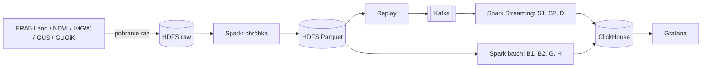
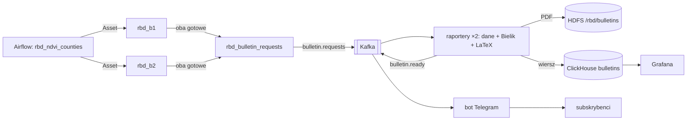

# Monitorowanie zagrożeń dla upraw

*Rozproszone Przetwarzanie Danych w Big Data · plan pracy: [ROADMAP.md](ROADMAP.md)*

**Stan (31.10.2026):** klaster i wszystkie narzędzia działają (sekcja 6); procesy **B1 i B2 gotowe** — od NDVI w HDFS do biuletynu PDF z komentarzem modelu Bielik, rozsyłanego botem Telegram (subskrypcje, mapy i wykresy na żądanie) i sprawdzonego na plonach GUS (sekcje 5 i 7). Pogoda ERA5-Land jeszcze się pobiera — po komplecie przeliczamy pogodę (DAG `rbd_weather_counties`) i biuletyny.

## 1. Projekt

Z historycznych danych pogodowych i satelitarnych liczymy zagrożenia dla upraw w regionach Polski. Część procesów to **strumień** (alerty co godzinę), część **batch** (całe sezony). Strumień symulujemy: archiwalne dane odtwarzamy do Kafki, jakby przychodziły na żywo. Dane pobieramy raz, więc demo zawsze działa tak samo. Wyniki: ClickHouse + Grafana.

## 2. Rolnictwo w pigułce

- **Oziminy** (pszenica, rzepak) — siane jesienią, zimują w polu, zbiór w lipcu. **Jare** (jęczmień, kukurydza, ziemniaki, buraki) — siane wiosną.
- **Plon** — dt/ha (1 dt = 100 kg); pszenica ok. 45–60 dt/ha.
- **NDVI** — „zieloność” ze zdjęć satelitarnych (0,1 goła ziemia … 0,9 pełny wzrost). W roku ma kształt górki ze szczytem w maju–czerwcu.
- **Bilans wodny (KBW)** = opad − ET₀ (parowanie). Długo ujemny = susza.

| Okres | Zagrożenie | Próg (w konfiguracji) | Proces |
| --- | --- | --- | --- |
| XII–II | **wymarzanie ozimin** | < −18 °C bez śniegu; ≥ 10 cm śniegu chroni do ok. −23 °C | D |
| IV–VI | **przymrozki** | rzepak −4 °C, zboża jare −4 °C, kukurydza/ziemniaki 0 °C; przy gruncie jest o ok. 1,6 °C zimniej niż na 2 m | S2 |
| III–IX | **susza** | KBW z 60 dni < −150 mm (uproszczenie definicji IUNG) | S1, H |
| VII–X | wynik roku: **plon** | — | B2 |

Testujemy na: zimie **2011/12** (do −30 °C bez śniegu, duże straty ozimin) i suszach **2018, 2019**.
Źródła progów: [farmer.pl](https://www.farmer.pl/produkcja-roslinna/rzepak/kiedy-wymarza-rzepak,76958.html), [agrofakt.pl](https://www.agrofakt.pl/wymarzanie-zboz-rzepaku-moze-byc-realnym-zagrozeniem/), [farmer.pl — przymrozki](https://www.farmer.pl/produkcja-roslinna/ochrona-roslin/w-jakiej-temperaturze-przymrozki-uszkadzaja-rosliny-uprawne-wiosna-to-zalezy-od-gatunku,145219.html), [IUNG — KBW](https://www.iung.pl/2024/06/05/klimatyczny-bilans-wodny-od-1-kwietnia-do-31-maja-2024-roku/), [GUS — ocena upraw 2012](https://stat.gov.pl:443/cps/rde/xbcr/gus/RL_wiosenna_ocena_stanu_upraw_2012.pdf).

## 3. Dane

| Zbiór | Źródło | Zakres | Procesy | Notatnik |
| --- | --- | --- | --- | --- |
| Pogoda godzinowa | ERA5-Land (Copernicus CDS) | 2010–2024, siatka 0,1° (~4 100 punktów w Polsce), 10 zmiennych, **~0,5 mld wierszy**; pobieranie w toku, w biuletynach i mapach pogoda dla lat już pobranych | S1, S2, D, H, B1/B2 | 01 |
| NDVI | MODIS MOD13Q1 (250 m, co 16 dni) z [Microsoft Planetary Computer](https://planetarycomputer.microsoft.com/dataset/modis-13Q1-061) | 2001–2024, 549 terminów, **~2,8 mld pikseli** Polski (wycinek Polski na HDFS: 8,8 GB) | B1, B2, G, H | 02 |
| Mapa upraw | [EUCROPMAP](https://data.jrc.ec.europa.eu/collection/id-00346) (JRC, 10 m, z Sentinel-1/2) → udział 6 grup upraw w kwadratach 250 m | 2018, 2022 | maska pól ornych, struktura upraw, krzywe grup upraw | 02 |
| Pomiary stacji | IMGW (dane publiczne) | 2010–2024, 57 stacji | kalibracja S2, sprawdzanie ERA5-Land | 03 |
| Granice | GUGiK: WFS (wszystkie naraz) + [ULDK](https://uldk.gugik.gov.pl/opis.html) (jednostka po kodzie TERYT lub punkcie) | województwa, powiaty | wszystkie | 05 |
| Plony | [GUS BDL API](https://api.stat.gov.pl/Home/BdlApi) | 1999–2024 × 16 województw (**brak danych dla powiatów**) | B2, walidacja B1 | 04 |

Najważniejsze uwagi (szczegóły w notatnikach):
- ERA5-Land: temperatura w kelwinach, śnieg w metrach, opad **narasta od 00 UTC** (trzeba odejmować kolejne godziny). ET₀ liczymy sami (FAO-56).
- NDVI: Polskę pokrywają 4 kafelki MODIS (h18–h19, v03–v04), ok. 44 MB każdy na 16 dni. Link do pliku podpisujemy anonimowo przez API Planetary Computer (`/api/sas/v1/sign`). Chmury maskujemy warstwą `pixel_reliability`. Jeden produkt na całe 2001–2024, więc norma i bieżące lata są porównywalne.
- GUS: „pszenica” bez podziału na ozimą/jarą; brak uprawy zapisany jako 0. Limit bez klucza: 5 zapytań/s, 100/15 min, 1000/12 h — nam wystarczy.
- ULDK: `GetCountyByXY` przypisuje punkt (np. stację IMGW) do powiatu jednym zapytaniem; geometrie od razu w EPSG:4326 (`srid=4326`).

**Dostępy — jedno konto:**
- **Copernicus CDS** (pogoda, [instrukcja](https://cds.climate.copernicus.eu/how-to-api)): zaakceptować licencję ERA5-Land, plik `~/.cdsapirc` z tokenem (nie commitujemy), `pip install "cdsapi>=0.7.7"`.
- Bez kont: Planetary Computer (NDVI), JRC (EUCROPMAP), IMGW, GUS (opcjonalny klucz `X-ClientId` podnosi limity 5×), GUGiK.
- **Sieć klastra blokuje magazyn plików Microsoftu** (`*.blob.core.windows.net`, pliki Planetary Computer). NDVI pobieramy więc z laptopa przez VPN i wysyłamy prosto na HDFS (`lib/ingest_modis_ndvi.py`, WebHDFS). Klucz CDS leży na masterze (`~/.cdsapirc`, prawa 600), ERA5-Land pobiera `lib/ingest_era5_land.py` (2 zamówienia na miesiąc — limit wielkości zamówienia w CDS).

**Dane na HDFS** (pliki z replikacją 2 — awaria jednej maszyny nie gubi danych; `REPLICATION` w `lib/webhdfs.py`, Spark: `spark.hadoop.dfs.replication=2`):

| Ścieżka | Co | Skrypt |
| --- | --- | --- |
| `/rbd/raw/modis_ndvi_poland/<rok>/` | NDVI MODIS, wycinek Polski, 549 terminów 2001–2024 | `lib/ingest_modis_ndvi.py` |
| `/rbd/raw/era5_land/<rok>/` | ERA5-Land godzinowo, 10 zmiennych, `_instant.nc` + `_accum.nc` na miesiąc | `lib/ingest_era5_land.py` |
| `/rbd/ref/boundaries/`, `/rbd/ref/crops/` | granice powiatów i województw, mapy upraw EUCROPMAP 2018/2022 | `lib/boundaries.py`, `B1_B2/prepare_counties_crops.py` |
| `/rbd/clean/ndvi_counties/` | NDVI pól per powiat i termin (Parquet) — wspólne dla B1, B2, G, H | `lib/ndvi_zonal_spark.py` |
| `/rbd/clean/b1_*`, `/rbd/clean/b2_phenology/` | wyniki B1 i B2 (też w ClickHouse) | `B1_B2/b1_crop_condition.py`, `B1_B2/b2_phenology.py` |
| `/rbd/clean/weather_counties_*` | pogoda per powiat: dzień i termin 16-dniowy (opad, ET₀, bilans wody z 60 dni, upały, przymrozki; też w ClickHouse `weather_periods`) | `lib/era5_counties_spark.py` |
| `/rbd/clean/weather_grid_periods/` | bilans wody (opad − ET₀) na siatce ERA5-Land, ~4 400 punktów × termin — mapy suszy jak w IMGW (też w ClickHouse `weather_grid_periods`) | `lib/era5_kbw_grid_spark.py` |
| `/rbd/bulletins/<rok>/` | biuletyny PDF: `<powiat>_<rok>_p<termin>.pdf` | `B1_B2/reporter/reporter.py` |

## 4. Architektura

**Replay:** zima 2011/12 wysyłana do Kafki w tempie 1 h danych = 1 s, z oryginalnym czasem zdarzenia (event time, watermark).

### Przepływ danych ze źródeł

## 5. Procesy

| Id | Proces | Tor | Wejście → wynik |
| --- | --- | --- | --- |
| S1 | Potrzeba nawodnienia | strumień | (ERA5-Land) opad, ET₀, wilgotność gleby → sygnał „brak wody” |
| S2 | Przymrozki | strumień | (ERA5-Land) temperatura powietrza i gleby → alert |
| D | Wymarzanie ozimin | strumień | (IMGW) temperatura + śnieg → ryzyko dla województwa |
| B1 | Stan upraw — **gotowe** | batch | NDVI → powiaty „gorzej / typowo / lepiej niż zwykle” względem normy z 15 poprzednich lat |
| B2 | Fenologia — **gotowe** | batch | krzywa NDVI → start, szczyt, koniec sezonu względem typowych dat |
| G | Prognoza plonów | batch | NDVI + pogoda (ERA5-Land?/IMGW?) + plony GUS (2010–2024, 240 obserwacji na uprawę) → plon |
| H | Anomalie NDVI | batch | NDVI + bilans wodny → regiony i daty do kontroli |

- D: godzina groźna = temperatura < progu (tabela w sekcji 2). Okno 72 h; alarm, gdy ≥ 50% punktów z oziminami w województwie ma ≥ 6 groźnych godzin (ostrzeżenie ≥ 30%).
- H: (1) nagły spadek NDVI poniżej wygładzonej krzywej z G; (2) sezon poniżej mediany z lat 2001–2017. Normy nie liczymy z lat 2018–2024, bo zawierają testowane susze.
### B1 + B2 — biuletyn stanu upraw

**Cel biznesowy.** Wcześnie i tanio wiedzieć, **gdzie w Polsce uprawy mają się gorzej niż zwykle i dlaczego** — zanim straty pokażą się w plonach i statystykach GUS (te są dostępne dopiero po sezonie i tylko dla województw). Odbiorcy: ubezpieczyciele rolni (gdzie spodziewać się szkód), skupy i przetwórcy (gdzie mniej surowca), doradztwo i administracja (gdzie pomóc, gdzie szacować straty suszowe). Co 16 dni w sezonie (IV–IX) dla każdego z 314 powiatów ziemskich dostają biuletyn PDF na wzór JRC MARS: czy uprawy są w gorszym stanie niż zwykle, czy sezon jest przesunięty i co mogło to spowodować — automatycznie, z danych satelitarnych i pogodowych, bez objazdów w terenie.

- **B1 — stan upraw:** NDVI pól ornych powiatu (maska EUCROPMAP) porównany z normą z **15 poprzednich lat** bez lat skrajnych (do 2010 r. stała 2001–2017; pola z czasem zielenieją, więc porównujemy z niedawną przeszłością). Status: „gorzej niż zwykle / typowo / lepiej niż zwykle” (|z| ≥ 1).
- **B2 — przebieg sezonu:** z wygładzonej krzywej NDVI (Savitzky–Golay) start i koniec (50% wysokości górki) oraz szczyt; status względem typowych dat: „wcześniej / typowo / później niż zwykle”. Osobne krzywe dla grup upraw (ozime i rzepak, jare zboża, kukurydza, okopowe, łąki) w latach map EUCROPMAP.
- **Pogoda per powiat** (ERA5-Land): opad, parowanie ET₀ (FAO-56), bilans wody z 60 dni (susza: < −150 mm), dni upału i przymrozków — z nich reguły „możliwych przyczyn”.
- **Widok `b1b2_*` w ClickHouse** odróżnia słabsze uprawy od przesuniętego sezonu (np. 2020: chłodna wiosna — rośliny spóźnione, nie słabsze).
- **Biuletyn** (LaTeX, 2 strony w dwóch kolumnach): stan upraw, sezon, struktura upraw, pogoda, ocena i przyczyny, mapa województwa. **Bielik 11B** pisze streszczenie i ocenę wyłącznie z liczb biuletynu; odpowiedź jest sprawdzana automatycznie (format, każda liczba musi pochodzić z danych, przyczyna z listy) — gdy nie przejdzie, zostają teksty z reguł.

Asynchronicznie: obliczenia tylko wrzucają zlecenia do Kafki i nie czekają na model (ok. 3–5 min na komentarz na CPU). Dwa raportery (worker1, worker3 — po jednym Bieliku) w jednej grupie konsumentów dzielą się zleceniami; awaria w trakcie = zlecenie wraca do kolejki.

| Część | Kod | Uruchomienie |
| --- | --- | --- |
| B1, B2 (Spark) | `B1_B2/b1_crop_condition.py`, `B1_B2/b2_phenology.py`, `B1_B2/b1b2_context.py` | DAG-i `rbd_b1`, `rbd_b2` (`B1_B2/dags/b1_b2_pipeline.py`) |
| Pogoda per powiat + mapa bilansu wody (Spark) | `lib/era5_counties_spark.py`, `lib/era5_kbw_grid_spark.py` | DAG `rbd_weather_counties` (oba kroki po kolei) |
| Biuletyn PDF | `B1_B2/bulletin/build_bulletin.py`, `template.tex` | ręcznie: `--county 3011 --year 2018 --period 10` |
| Raporter (Kafka → Bielik → PDF) | `B1_B2/reporter/reporter.py`, `bielik.py` | usługa `rbd-reporter`; zlecenia: DAG `rbd_bulletin_requests` albo `B1_B2/reporter/request_bulletins.py` |
| Bot Telegram | `B1_B2/reporter/telegram_bot.py`, `bot_charts.py` | usługa `rbd-telegram` |
| Walidacja z GUS | `B1_B2/validate_gus_yields.py`, `lib/gus_bdl.py` | ręcznie (kontener `rbd-python`) |

**Bot Telegram [@bulletin_project_bot](https://t.me/bulletin_project_bot)** — dostarczanie biuletynów (zapis = zgoda, bez filtrów spamu) i mapy/wykresy na żądanie. Format: `/polecenie [powiat] [rok] [dzień]` — powiat kodem TERYT albo nazwą, dzień jako `dd.mm`; pominięte = cała Polska / ostatni rok / koniec czerwca. Pomoc `/start` uczy formatu, błędy podpowiadają poprawny zapis.

| Polecenie | Co daje |
| --- | --- |
| `/powiat 3011`, `/woj 30`, `/wszystko` | subskrypcja: nowe PDF-y przychodzą same (z `bulletin.ready`); `/moje`, `/ostatni`, `/stop` |
| `/mapa 2018 15.07` | mapa Polski: ocena B1 w każdym powiecie |
| `/ndvi [powiat] 2018 15.07` | NDVI z satelity, piksele 250 m: Polska albo zbliżenie na powiat |
| `/kbw [powiat] 2018 15.07` | bilans wody z 60 dni na siatce ERA5-Land, klasy jak mapy IMGW (susza < −150 mm) |
| `/uprawy [powiat] 2022` | mapa upraw EUCROPMAP (grupa przeważająca w kwadracie 250 m) + struktura upraw |
| `/wykres 3011 2018`, `/woda 3011 2018`, `/porownaj 3011 1206 2018` | krzywa NDVI na tle normy z datami sezonu; opad, ET₀ i bilans wody; dwa powiaty |
| `/kody`, `/kody 30` | kody województw i powiatów |

Dane bota: ClickHouse (wyniki, `weather_grid_periods`) i HDFS (zdjęcia NDVI, mapa upraw). Subskrypcje: `rbd.tg_subscribers`, wysyłki: `rbd.tg_log`.

**Grafana:** „B1” (mapa powiatów, krzywa na tle normy), „B2” (daty sezonu), „Biuletyny” (lista PDF, udział komentarzy Bielika, czas, przyczyny), „Walidacja B1” (porównanie z plonami GUS).

#### Adresy narzędzi

**Stan klastra** (Docker Swarm: master 10.7.11.21 + worker1–4 10.7.11.22–25, dostęp przez VPN; konfiguracja w `infra/`, hasła w `~/rbd-build/<usługa>/.env` na masterze — nie w repo):

| Usługa | Adres | Gdzie | Uwagi |
| --- | --- | --- | --- |
| HDFS 3.4 | http://10.7.11.21:9870, `hdfs://10.7.11.21:9000` | NameNode na masterze, 4 DataNode'y | nasze pliki: replikacja 2 |
| Spark 4.0 | http://10.7.11.21:8080, `spark://10.7.11.21:7077` | master + 4 workery (24 rdzenie, 160 GB) | zadania: `infra/spark/submit.sh <skrypt.py>` |
| ClickHouse 26.8 | http://10.7.11.21:8123/play (natywny port 9001) | master | baza `rbd`, użytkownik `rbd` |
| Grafana 13 | http://10.7.11.21:3000 | master | dashboardy z `infra/grafana/dashboards/` |
| Kafka 4.3 + Kafka UI | `10.7.11.22–24:9092`, panel http://10.7.11.21:8090 | worker1–3 | tematy ×3 kopie, bez auto-tworzenia tematów |
| Airflow 3.3 | http://10.7.11.21:8091 | master | zadania jako kontenery `rbd-python` (DockerOperator) |
| Bielik 11B (Ollama 0.34) | `127.0.0.1:11434` na każdej z maszyn | worker1, worker3 (etykieta `bielik=true`) | model `Bielik-11B-v3.0-Instruct` Q4_K_M, 4 rdzenie / 12 GB |
| Raporter biuletynów | — | worker1, worker3 (obok Bielika) | obraz `rbd-reporter` (rbd-python + TeX Live + klient Kafki), tematy `bulletin.requests` → `bulletin.ready` |
| Bot Telegram | — | master | obraz `rbd-reporter`; sieć klastra blokuje Telegram — ruch bota idzie tunelem SSH przez laptop (`infra/telegram/tunnel.ps1`) |

Wspólny obraz `rbd-python:0.1` (Spark 4.0 + Python 3.10 + rasterio, geopandas, pyarrow, cdsapi, xarray) jest na każdej maszynie: `infra/rbd-python/Dockerfile`.

Dashboardy Grafany (wejście: http://10.7.11.21:3000):

| Dashboard | Adres |
| --- | --- |
| B1 — stan upraw | http://10.7.11.21:3000/d/rbd-b1 |
| B2 — przebieg sezonu | http://10.7.11.21:3000/d/rbd-b2 |
| Biuletyny — raportery i Bielik | http://10.7.11.21:3000/d/rbd-bulletins |
| Walidacja B1 — plony GUS | http://10.7.11.21:3000/d/rbd-validation |

## 6. Narzędzia

Wszystkie poniższe działają na klastrze (Docker Swarm); w B1/B2 każde ma swoją rolę:

| Narzędzie | Rola w B1/B2 |
| --- | --- |
| Docker Swarm | uruchamia usługi na 5 maszynach (stacki w `infra/`) |
| HDFS + Parquet | surowe NDVI i pogoda, wyniki pośrednie, PDF-y biuletynów |
| Spark 4.0 | NDVI i pogoda per powiat, B1, B2 (przetwarzanie równoległe na 4 workerach) |
| ClickHouse | wyniki do Grafany, biuletynów i bota; widoki `b1b2_*` |
| Grafana | dashboardy B1, B2, Biuletyny, Walidacja B1 |
| Airflow | łańcuch NDVI → B1 + B2 → zlecenia biuletynów (Assets) i pogoda |
| Kafka + Kafka UI | kolejka zleceń biuletynów i gotowych PDF-ów (asynchronicznie) |
| Ollama + Bielik 11B | komentarz analityka w biuletynie (2 maszyny) |
| LaTeX | skład PDF (2 strony, dwie kolumny) |
| Telegram (bot) | subskrypcje i dostarczanie biuletynów, mapy i wykresy na żądanie |

Nie wdrożone (nie były potrzebne w B1/B2): Prometheus + cAdvisor, pandera, GitHub Actions, MLflow (G).

## 7. Jak sprawdzamy wyniki

Porównujemy ze źródłami, których **nie używamy w obliczeniach**. Cele to propozycja na start.

| Proces | Porównujemy z | Cel |
| --- | --- | --- |
| Dane ERA5-Land | stacje IMGW | błąd temperatury ≤ 2 °C |
| D | [GUS — Wiosenna ocena stanu upraw](https://stat.gov.pl/obszary-tematyczne/rolnictwo-lesnictwo/uprawy-rolne-i-ogrodnicze/wiosenna-ocena-stanu-upraw-rolnych-i-ogrodniczych-w-2024-roku,10,21.html) (co roku); spadek plonu rzepaku 2012 | alarmy w latach i województwach ze stratami |
| S2 | IMGW: minimum przy gruncie | ≥ 70% przymrozków złapanych, ≤ 30% fałszywych alarmów |
| S1 | [IUNG — monitoring suszy](https://susza.iung.pulawy.pl) | te same okresy suszy |
| H | [European Drought Observatory](https://drought.emergency.copernicus.eu) (wskaźnik suszy, stan roślinności) | anomalie 2018–2019 tam, gdzie EDO |
| B2 | [Copernicus HR-VPP](https://collections.sentinel-hub.com/vegetation-phenology-and-productivity-parameters-season-1) (wymaga konta Copernicus Data Space — nie zrobione) | ta sama kolejność lat (wcześniejszy/późniejszy sezon) |
| G | plony GUS z lat pominiętych w uczeniu; [JRC MARS](https://joint-research-centre.ec.europa.eu/scientific-activities/crop-monitoring-and-yield-forecasting_en) | lepiej niż „średnia z 3 poprzednich lat” |
| B1 | plony GUS (województwa, 2004–2024) — **zrobione** | NDVI i plon w tę samą stronę |

**Wynik B1 vs plony GUS** (`B1_B2/validate_gus_yields.py`, dashboard „Walidacja B1”; 1343 pary województwo × rok × uprawa): odchylenie NDVI w sezonie IV–IX koreluje z odchyleniem plonu dla wszystkich upraw (p < 0,001) — jęczmień r = 0,52, pszenica 0,49, buraki 0,30, rzepak 0,22. Gdy ≥ 50% powiatów województwa jest „gorzej niż zwykle”, plon GUS jest poniżej normy w 44% przypadków, a gdy < 10% powiatów — w 9% (pszenica: 59% vs 5%). Najlepiej dla zbóż; rzepak zależy też od zimy i szkodników, buraki od jesieni (poza sezonem IV–IX). Uwaga: plony rosną z roku na rok, więc norma z 15 lat jest zaniżona i „poniżej normy” zdarza się rzadko.
